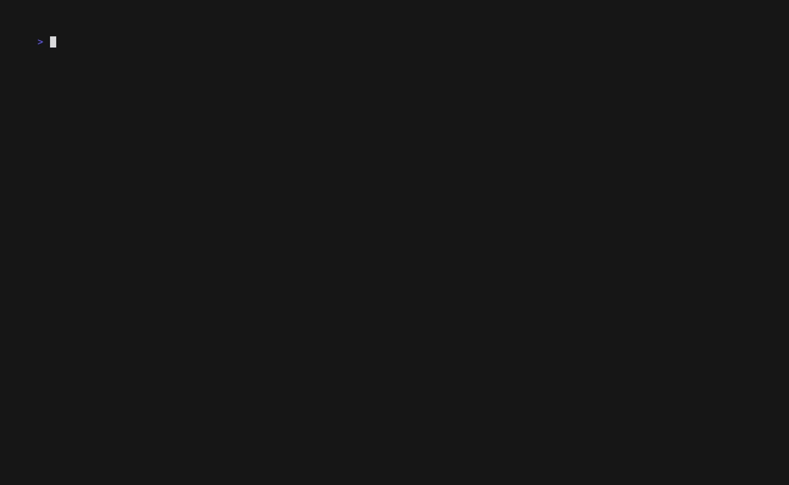

# lgtm

lgtm explains a commit to you before you approve it.

You run it in a git repository and pick a commit, or your uncommitted changes. A language model reads the change and the code around it, and writes a short explanation that you step through in the terminal. It tells you what the code did before, what it does now, and how the new code works. At the end it asks you a question about the change, so you can tell whether you understood it.

The name comes from the "lgtm" people type on a pull request. Most of the time it gets typed without the change being read, because there is more code to review than anyone has time for. You run this first, read what the change does, and then decide.

## What it looks like

When you run `lgtm` you get the history of the repository. Your uncommitted changes are the first row if you have any. Below that are the commits, newest first, under the day they were made. A day with a lot of commits shows four of them and a row that says how many more there are.

Start typing and the list narrows to the commits that match, by message, hash or author. Press enter on one and the model starts reading.

While it reads, the page shows what it is doing. You see each file it opens and each search it runs, and a few lines of what it is thinking. This usually takes fifteen to thirty seconds.

Then the explanation opens. For a commit it has these parts:

1. Three sentences at the top that say what behaves differently, what kind of change it is, and where in the code it is.
2. A before and after. You step between the two with the arrow keys. Each one takes the same input and shows what came back, with the old code under the first and the new code under the second.
3. How the new code works, a step at a time. Each step shows the lines it is talking about, read from your files.
4. What the tests in the commit check, if it has any.
5. One or two questions. Each has two hints and an answer, and each asks for something you should know before you accept the change.

A ten-line commit gets a short explanation. A large one gets a longer one, and a chart of where the lines went.

lgtm is not a reviewer. It will not tell you the change is good or bad, and it does not look for bugs or missing tests.

## Questions about the code

You can also ask it something that has nothing to do with a commit.

    lgtm "what happens when a request comes in?"

It reads the repository and answers in the same kind of document, usually with a small diagram of the steps or the parts involved. You can type a question on the history page too. If what you type matches no commit, enter asks it.

## What to know before you use it

The code it reads is sent to the model you configure. If that is a hosted model, the code leaves your machine.

It can only read. The model can list files, search them, read them, and look at git history. It cannot change or run anything.

It does not read files that git ignores. Those are often secrets, such as a `.env` file.

The explanations are saved in your system's temporary folder, in a folder for each repository. Nothing is written into the repository itself. A commit you already had explained opens the saved explanation and has a tick next to it in the history. A question is sent to the model again every time, because the code may have changed since you last asked.

## Install

You need Go and git.

    git clone https://github.com/mdijkstra-oss/lgtm
    cd lgtm
    go install ./cmd/lgtm

## Choose a model

lgtm has no model of its own. You tell it which one to use with environment variables, or with the same names in `~/.lgtm/config.json`:

    {
      "LGTM_MODEL": "the-model-id",
      "OPENAI_BASE_URL": "https://your-endpoint/v1",
      "OPENAI_API_KEY": "your-key"
    }

| Name | What it does |
|---|---|
| `LGTM_MODEL` | The id of the model, written the way its provider writes it. You have to set this. |
| `OPENAI_BASE_URL` | The address of any service that speaks the OpenAI API. When this is set, lgtm uses it, with `OPENAI_API_KEY` as the key. |
| `ANTHROPIC_API_KEY`, `OPENAI_API_KEY`, `OPENROUTER_API_KEY`, `GEMINI_API_KEY` | When no base URL is set, lgtm uses the provider of the first of these it finds. |
| `LGTM_EFFORT` | How much the model thinks before it writes. One of `none`, `minimal`, `low`, `medium`, `high`. It is `low` if you leave it out, which is a few seconds faster than the model's own default. It is only sent when `OPENAI_BASE_URL` is set. |

If a name is set in both places, the environment variable is used.

## Commands

| Command | What it does |
|---|---|
| `lgtm` | Opens the history of the repository you are in. |
| `lgtm <commit>` | Explains that commit. You can give anything git understands as a commit, such as a hash, a branch name or `HEAD~2`. |
| `lgtm "a question"` | Answers the question. |
| `lgtm ask --plain <commit or question>` | Prints the document as markdown and does not open the viewer. With nothing after `--plain` it explains your uncommitted changes. This also happens when the output is piped. |
| `lgtm intro` | Plays the opening animation and nothing else. |

## Keys

On the history page:

| Key | What it does |
|---|---|
| up, down | Move through the list. |
| enter | Explain the commit you are on, or open its explanation if it has a tick. |
| any text | Narrow the list. If nothing matches, enter asks what you typed as a question. |
| 1 to 5 | Open one of your earlier questions, listed at the bottom. This works while the search line is empty. |
| esc | Go back to the document you had open, or quit if there is none. |

In a document:

| Key | What it does |
|---|---|
| up, down | Move a line at a time. |
| left, right | Step through the parts of a block, such as before and after. |
| 1 to 9 | Jump to a section. |
| enter | Show more of the file around the code you are on. |
| `[`, `]` | Switch between open documents. |
| ctrl+k | Go back to the history. |
| q | Quit. |

## Working on lgtm

`AGENTS.md` has the make targets and the rules the code follows.

The instructions the model gets are in `internal/features/ask/prompt.md`. If you change them, `docs/eval` has a script that explains six commits of the chi router and saves the results, and a list of what to judge them on.

`make demo` records the animation at the top of this page again. It clones chi and asks a real model, so you need lgtm set up first.
