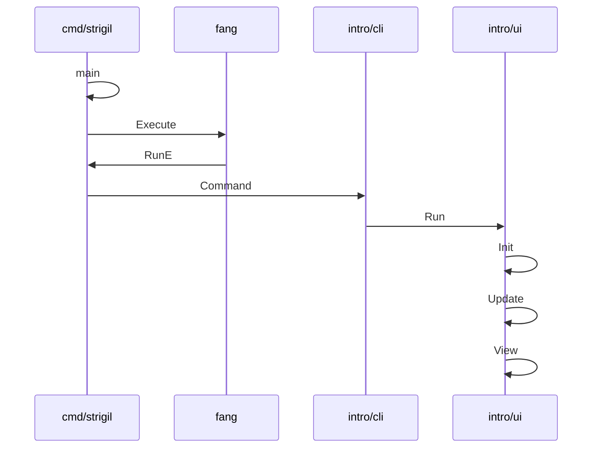
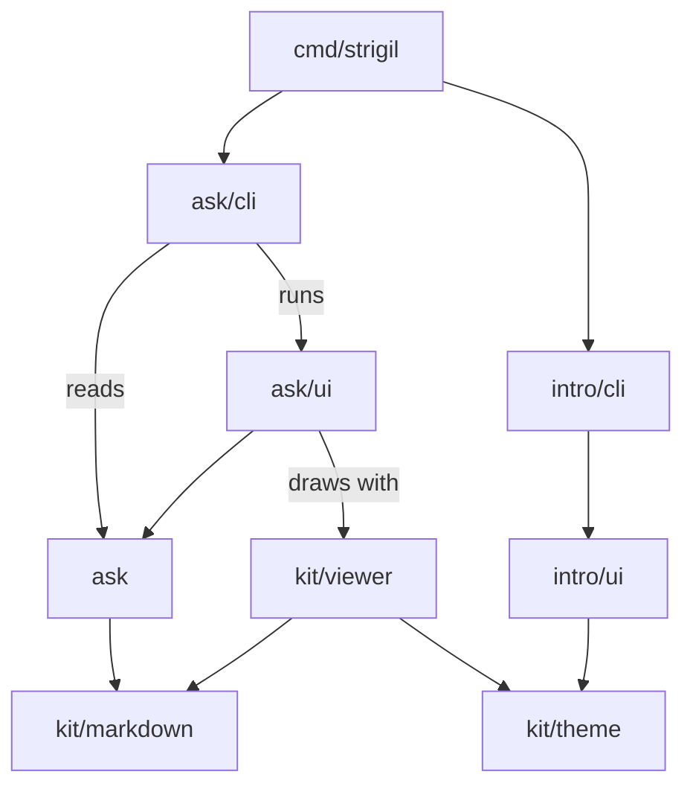

# What a document can be made of

A document is one markdown file, and nothing in it is syntax of our own. Any markdown reader shows it whole. This viewer recognises a few ordinary things in it and shows them better. Each is below, on this repository, with how it is written and what it is for.

- `##` starts a section, and is a line of the index.
- `###` starts a subsection. Here the subsections of a section are shown one at a time, and left and right go through them. Elsewhere they stand one under the other.
- A link to lines of a file, a `mermaid` fence, a colour in a code span, and a table of lines added and removed are each shown as what they mean.

## Subsections

For anything that comes in cases, steps or parts, where the reader wants one at a time. A subsection is a third-level heading and what stands under it, which is whatever a section can hold.

    ### ✓ 60 by 12 and up
    `render` draws the page.

    ### ✗ smaller
    Below that size the frame is empty.

A ✓ or ✗ before a name marks the subsection. That makes the subsections a claim tried on cases: one ✗ marks the section in the index. Without marks they are plain steps.

Here, whether the intro page draws at every window size:

### ✓ 60 by 12 and up
`render` draws the page.

[ui/intro.go](internal/features/intro/ui/intro.go#L183-L192)

### ✗ smaller
The content is set only inside the `if`. Below that size the frame is empty, though the keys still work.

[ui/intro.go](internal/features/intro/ui/intro.go#L183-L192)

## Sequence

For a question about order: what happens when, and who calls whom. It is a Mermaid `sequenceDiagram`. Each message is drawn in the lane it goes to, and a message named as a subsection is that subsection, so the drawing is what the subsections are picked from.

    sequenceDiagram
      participant strigil as cmd/strigil
      strigil->>fang: Execute
      fang->>strigil: RunE

    ### Execute
    Parses the arguments.

Here, what plain `strigil` does up to its first frame:



### main
Builds the root command, adds each feature's command to it, and hands the lot to fang.

[strigil/main.go](cmd/strigil/main.go#L18-L31)

### Execute
Parses the arguments and draws help and errors. With no subcommand it runs the root's own `RunE`.

### RunE
Nothing was asked for, so it builds intro's command and calls that. `main` may import a feature's `cli` package and nothing else, which is why it goes through the command.

[strigil/main.go](cmd/strigil/main.go#L19-L23)

### Command
`strigil intro` arrives here directly.

[cli/cli.go](internal/features/intro/cli/cli.go#L10-L17)

### Run
Starts the Bubble Tea program on a freshly covered page.

[ui/intro.go](internal/features/intro/ui/intro.go#L66-L70)

### Init
Asks for the first tick.

[ui/intro.go](internal/features/intro/ui/intro.go#L84-L88)

### Update
The first message is the window size. It sizes the page and scatters the sentences over it.

[ui/intro.go](internal/features/intro/ui/intro.go#L90-L92)

### View
Takes the alternate screen, sets the background, and draws when the window is at least 60 by 12.

[ui/intro.go](internal/features/intro/ui/intro.go#L183-L192)

## Graph

For what has no order: what imports what, what owns what. It is a Mermaid `flowchart`. Each node is a row under the first node that points at it. A node pointed at twice is named twice, and what it points at is drawn only the first time.

    flowchart TD
      strigil["cmd/strigil"] --> askcli["ask/cli"]
      askcli -->|runs| askui["ask/ui"]

    ### ask/ui
    The palette and the tabs.

A node with no subsection is drawn and passed over. Here, the imports that give this repository its shape:



### cmd/strigil
Lists the commands. It may import a feature's `cli` package and nothing else of it.

[strigil/main.go](cmd/strigil/main.go#L14-L16)

### ask/cli
`strigil ask`: reads the documents and hands them to the frame.

### ask
The documents there are, and finding one by its title.

### ask/ui
The palette and the tabs.

### kit/viewer
A document on screen. It knows the format and the colours, and no feature.

### kit/markdown
What a document is made of, and the parser. It imports nothing of this repository.

### kit/theme
Every colour, named for its job. The only package that may import the palette. Its brand colour is `#6b50ff`.

[theme/theme.go](internal/kit/theme/theme.go#L9-L13)

## Code

For a few lines the reader has to see to follow the text. It is an ordinary link to a file, with the lines after `#L` as GitHub writes them, alone on its line. The lines are read from the file, so they are never written out and cannot disagree with it. Enter gives the file the whole view.

    [markdown/parse.go](internal/kit/markdown/parse.go#L12-L18)

[markdown/parse.go](internal/kit/markdown/parse.go#L141-L142)

A fence with code in it stays what it is anywhere, code in the colours of its language:

```go
for _, c := range commands {
    root.AddCommand(c())
}
```

## Colours

A colour in a code span is shown as itself, wherever it stands. It can be hex, `rgb(104, 255, 214)` or `hsl(338 81% 59%)`, as CSS writes them: `#6b50ff` in a sentence, or down a table. Here, the dark theme:

| name | colour | job |
|---|---|---|
| `Primary` | `#6b50ff` | the active frame, the chosen row |
| `Secondary` | `#ff60ff` | the live point: cursor, focused control |
| `Accent` | `#68ffd6` | the input prompt |
| `Text1` | `#ecebf0` | names, titles, values |
| `Text2` | `#bfbcc8` | long-form body |
| `Text4` | `#605f6b` | what a key does, placeholders |
| `Error` | `#eb4268` | wrong, on an icon or a small tag |
| `Warning` | `#f5ef34` | take care |
| `Success` | `#00ffb2` | good |

## Bars

For a commit or a branch: what went out and what came in, part by part. It is a table with a column of `+n` and a column of `-n`. Each row is drawn as a bar, lines removed to the left and lines added to the right, all to one scale.

Here, commit `0e30354`, which replaced the first interface with the intro page:

| part | added | removed | what happened |
|---|---|---|---|
| features/intro | +838 | -0 | The command, the page, four snapshots and slop.txt. |
| kit/theme | +162 | -112 | Rewritten onto tone, with the test that polices it. |
| .go-arch-lint.yml | +24 | -41 | Rows for the removed packages went, rows for intro and theme came. |
| cmd/strigil | +6 | -75 | gallery.go and its test went; main lists one command. |
| go.mod | +3 | -4 | bubbles and catppuccin went, tone and harmonica came. |
| features/search | +0 | -1188 | The search command, its logic and its page. |
| kit/palette | +0 | -787 | The ctrl+k palette. |
| shell | +0 | -562 | The frame that held tabs and the palette. |
| samples | +0 | -291 | Text files the search was tried on. |
| features/gallery | +0 | -191 | The viewer that stepped through stories. |
| kit/tabs | +0 | -191 | |
| kit/text | +0 | -167 | |
| kit/frame | +0 | -140 | |
| kit/hints | +0 | -74 | |
| kit/kit.go | +0 | -46 | |

## Choosing

- What happens when: a sequence, with a subsection a step.
- What depends on what: a graph.
- Is it always so: subsections marked ✓ and ✗.
- What did this commit do: a table of lines added and removed.
- Which colours: their values, in code spans.
- Anything else: text, and a link to the few lines that must be read.
