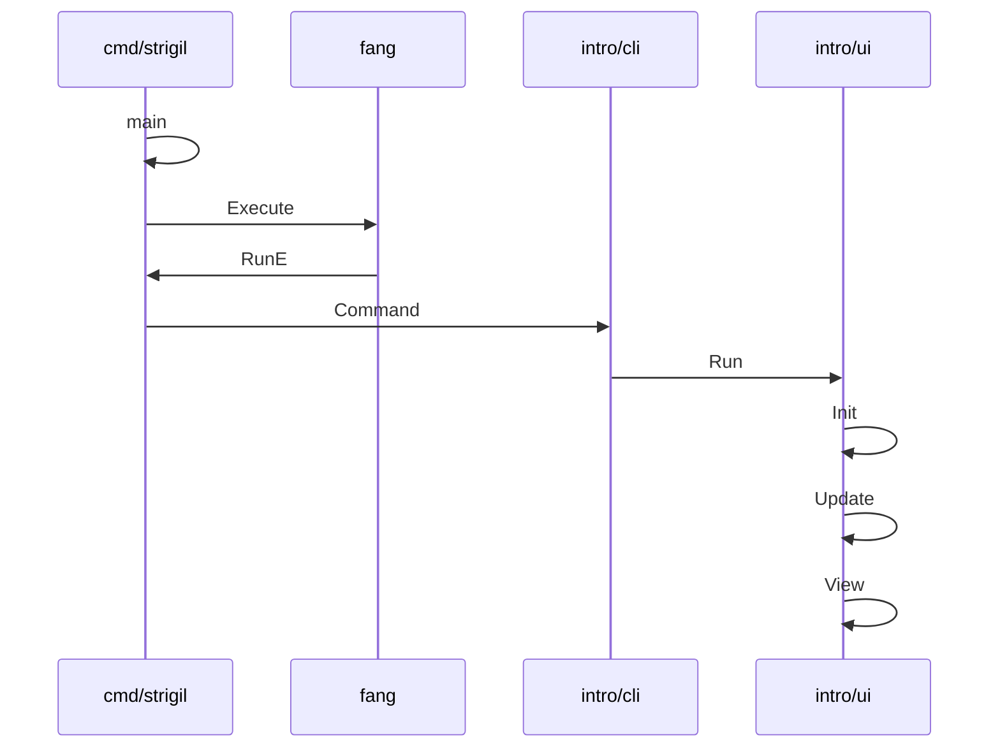
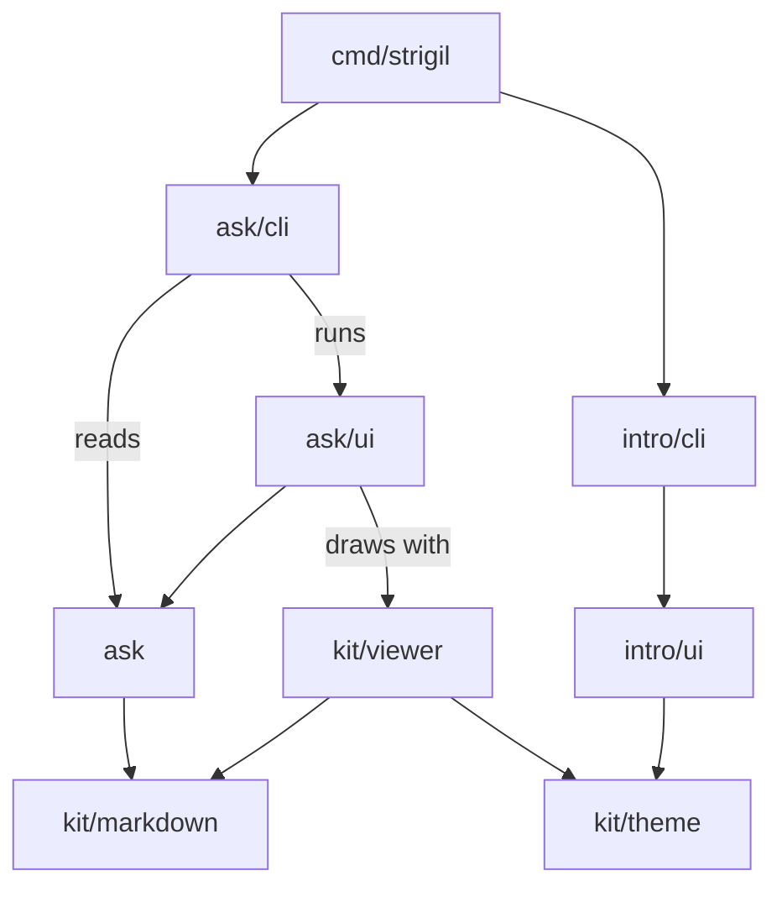

# What a document can be made of

A document is one markdown file. Headings give it its shape, and a few fences stand for things text says badly: lines of a file, colours, numbers, a drawing. Each is shown below on this repository, with how it is written and what it is for.

- `##` starts a section, and is a line of the index.
- `###` starts a subsection. Here the subsections of a section are shown one at a time, and left and right go through them. Any other markdown reader shows them one under the other, and nothing is lost.
- A fence named `code`, `swatch`, `bars` or `mermaid` is a block.

## Subsections

For anything that comes in cases, steps or parts, where the reader wants one at a time. A subsection is a third-level heading and what stands under it. It holds whatever a section can: text and any of the blocks. On a line of a block in a subsection, left and right are that block's.

    ### [ok] 60 by 12 and up
    `render` draws the page.

    ### [bad] smaller
    Below that size the frame is empty.

`[ok]` or `[bad]` before a name marks the subsection. That makes the subsections a claim tried on cases: one that breaks marks the section in the index. Without marks they are plain steps.

Here, whether the intro page draws at every window size:

### [ok] 60 by 12 and up
`render` draws the page.

```code
internal/features/intro/ui/intro.go:180-189 !185-186
```

### [bad] smaller
The content is set only inside the `if`. Below that size the frame is empty, though the keys still work.

```code
internal/features/intro/ui/intro.go:180-189 !185
```

## Sequence

For a question about order: what happens when, and who calls whom. It is a Mermaid `sequenceDiagram`. Each message is drawn in the lane it goes to, and a message named as a subsection is that subsection, so the drawing is what the subsections are picked from.

    sequenceDiagram
      cmd/strigil->>fang: Execute
      fang->>cmd/strigil: RunE

    ### Execute
    Parses the arguments.

Here, what plain `strigil` does up to its first frame:



### main
Builds the root command, adds each feature's command to it, and hands the lot to fang.

```code
cmd/strigil/main.go:18-31 !28
```

### Execute
Parses the arguments and draws help and errors. With no subcommand it runs the root's own `RunE`.

### RunE
Nothing was asked for, so it builds intro's command and calls that. `main` may import a feature's `cli` package and nothing else, which is why it goes through the command.

```code
cmd/strigil/main.go:19-24 !23
```

### Command
`strigil intro` arrives here directly.

```code
internal/features/intro/cli/cli.go:10-17 !15
```

### Run
Starts the Bubble Tea program on a freshly covered page.

```code
internal/features/intro/ui/intro.go:64-67 !65
```

### Init
Asks for the first tick.

```code
internal/features/intro/ui/intro.go:81-85 !81
```

### Update
The first message is the window size. It sizes the page and scatters the sentences over it.

```code
internal/features/intro/ui/intro.go:89-100 !91-93
```

### View
Takes the alternate screen, sets the background, and draws when the window is at least 60 by 12.

```code
internal/features/intro/ui/intro.go:180-189 !185-186
```

## Graph

For what has no order: what imports what, what owns what. It is a Mermaid `flowchart`. Each node is a row under the first node that points at it. A node pointed at twice is named twice, and what it points at is drawn only the first time.

    flowchart TD
      cmd/strigil --> ask/cli
      ask/cli -->|runs| ask/ui

    ### ask/ui
    The palette and the tabs.

A node with no subsection is drawn and passed over. Here, the imports that give this repository its shape:



### cmd/strigil
Lists the commands. It may import a feature's `cli` package and nothing else of it.

```code
cmd/strigil/main.go:10-16 !16
```

### ask/cli
`strigil ask`: reads the documents and hands them to the frame.

### ask
The documents there are, and finding one by its title.

### ask/ui
The palette and the tabs.

### kit/viewer
A document on screen. It knows the format and the colours, and no feature.

### kit/markdown
What a document is made of, and the parser. It imports nothing of this repository.

### kit/theme
Every colour, named for its job. The only package that may import the palette.

```swatch
brand: Primary Secondary Accent OnPrimary
states: Error Warning Info Success
```

```code
internal/kit/theme/theme.go:9 !9
```

## Code

For a few lines the reader has to see to follow the text. It is a path and the lines to show, and after `!` the lines that matter. The lines are read from the file, so they are never written out and cannot disagree with it. Enter gives the file the whole view.

    internal/kit/theme/theme.go:1-9 !9

```code
internal/kit/theme/theme.go:1-9 !9
```

## Swatch

For a question about colours, where a name says little and the colour says it at once. A group a line, and in it names from the theme.

```swatch
brand: Primary Secondary Accent OnPrimary
text: Text1 Text2 Text3 Text4 Line
surfaces: Surface0 Surface1 Surface2 Surface3
code: CodeKeyword CodeType CodeFunction CodeString CodeNumber
states: Error Warning Info Success
```

## Bars

For a commit or a branch: what went out and what came in, part by part. A part a line: its name, lines added, lines removed, and a note. All bars are to one scale.

Here, commit `0e30354`, which replaced the first interface with the intro page:

```bars
features/intro +838 -0 The command, the page, four snapshots and slop.txt.
kit/theme +162 -112 Rewritten onto tone, with the test that polices it.
.go-arch-lint.yml +24 -41 Rows for the removed packages went, rows for intro and theme came.
cmd/strigil +6 -75 gallery.go and its test went; main lists one command.
go.mod +3 -4 bubbles and catppuccin went, tone and harmonica came.
features/search +0 -1188 The search command, its logic and its page.
kit/palette +0 -787 The ctrl+k palette.
shell +0 -562 The frame that held tabs and the palette.
samples +0 -291 Text files the search was tried on.
features/gallery +0 -191 The viewer that stepped through stories.
kit/tabs +0 -191
kit/text +0 -167
kit/frame +0 -140
kit/hints +0 -74
kit/kit.go +0 -46
```

## Choosing

- What happens when: a sequence, with a subsection a step.
- What depends on what: a graph.
- Is it always so: subsections marked `[ok]` and `[bad]`.
- What did this commit do: bars.
- Which colours: a swatch.
- Anything else: text, and a code fence where a few lines must be read.
